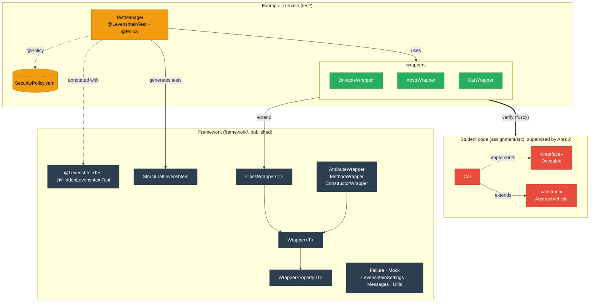
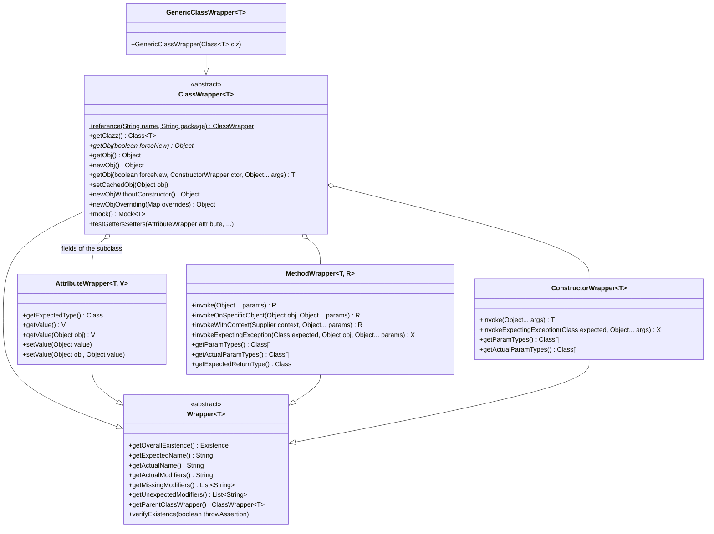
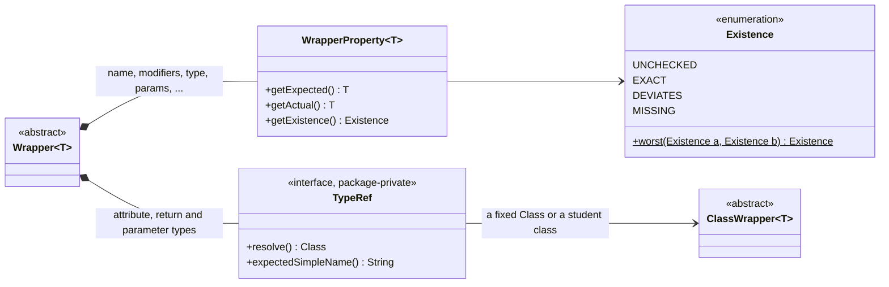
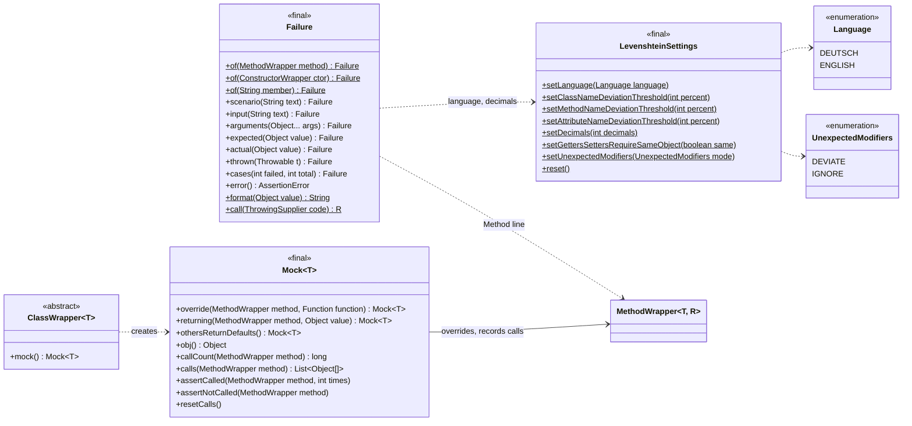
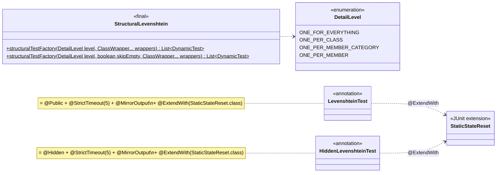
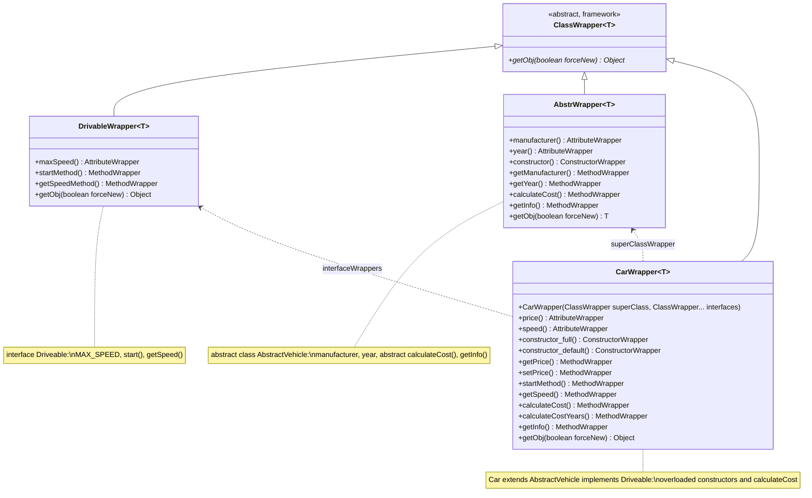

# Architecture

How the framework, an exam's tests and the student code fit together, which class does what, and how a wrapper
gets from "expected" to "found". For the exact signatures of every public class and method see the
[API Reference (Javadoc)](https://valentinherrmann.github.io/Levenshtein-Testing-Framework/api/); the diagrams on
this page show the parts you work with, not every method.

## Overview

Every expected class of the student code has a wrapper (a `ClassWrapper` subclass) that describes it. The wrapper
finds the student's actual class and members, even with small naming deviations. `TestManager` generates the
structural tests from the wrappers and uses the wrappers for the behavioural tests. Every test runs under Ares 2
supervision (`@LevenshteinTest` + `@Policy`).

## What happens in a test run

1. **Building the wrappers** (static field or `@BeforeAll`): each wrapper stores only what is *expected*: names,
   types, modifiers. Nothing is looked up yet, and no student code runs.
2. **First use, inside a supervised test**: the wrapper looks up its element once
   ([How Matching Works](matching.md)) and stores each part as a `WrapperProperty` (expected, actual,
   `EXACT`/`DEVIATES`/`MISSING`). The worst part is the wrapper's verdict.
3. **Structural tests** (`StructuralLevenshtein.structuralTestFactory`) fail for every wrapper that is not
   `EXACT` and print its `DEVIATION`/`MISSING` message.
4. **Behavioural tests** call the student's element through the wrapper (`invoke`, `getValue`, `newObj`, ...).
   A `DEVIATES` element is used as it is; a `MISSING` one fails the call. Exceptions of student code become a
   [failure block](writing-tests.md#reporting-failures) (`Failure`).
5. **Between tests**, `StaticStateReset` (part of `@LevenshteinTest`) resets attributes that are `static`
   although the test expects instance attributes, so tests do not influence each other.

## Packages and classes

**`io.github.valentinherrmann.levenshtein`** (framework, published)

| Class | Role |
|---|---|
| `Wrapper<T>` | Base of all wrappers: expected name and modifiers, verdict, messages, missing/unexpected modifiers |
| `ClassWrapper<T>` | A class, abstract class or interface: superclass, interfaces, instantiation (`newObj`, `newObjWithoutConstructor`, `newObjOverriding`, `mock`), `testGettersSetters`, `ClassWrapper.reference(name, package)` |
| `AttributeWrapper<T,V>`, `MethodWrapper<T,R>`, `ConstructorWrapper<T>` | Members: lookup, `getValue`/`setValue`, `invoke`, `invokeExpectingException` |
| `GenericClassWrapper<T>` | Wraps a class that is already loaded; used for the student's *actual* superclass and interfaces, not for expected classes |
| `WrapperProperty<T>` | Expected vs. actual value of one part plus its `Existence` |
| `StructuralLevenshtein` | JUnit `DynamicTest` factory for the structural tests (`DetailLevel`) |
| `Failure` | The structured failure block (`Method:`, `Scenario:`, `Input:`, `Expected:`, `Actual:`), also for your own checks |
| `Mock<T>` | Test-owned overrides and call records on an object of a student class |
| `LevenshteinTest` / `HiddenLevenshteinTest` | Composed annotations: `@Public`/`@Hidden` + `@StrictTimeout(5)` + `@MirrorOutput` + `@ExtendWith(StaticStateReset.class)` |
| `StaticStateReset` | JUnit extension that resets unexpectedly `static` attributes before each test |
| `LevenshteinSettings` | Runtime configuration: language, thresholds, decimals, getter/setter comparison, unexpected modifiers |
| `Messages` | German/English feedback texts |
| `Utils` | Levenshtein distance, type compatibility, `safeCast` |
| `TypeRef`, `Invocations`, `GettersSettersTest`, `MockClasses` (package-private) | Member types given as `ClassWrapper`, calling student code, getter/setter test, generated subclasses |

**`example-maven/`** and **`example-gradle/`** (not published): the same example exercise as two standalone
projects, one per build tool. Their `assignment/` and `test/` folders are identical (CI checks this) except
for one line in `SecurityPolicy.yaml`.

* `assignment/src/.../vehicles`: the "student" solution (`Car`, `AbstractVehicle`, `Driveable`), explained
  in [`SIMPLIFIED_CONCEPTS.md`](https://github.com/ValentinHerrmann/Levenshtein-Testing-Framework/blob/main/example-maven/SIMPLIFIED_CONCEPTS.md)
* `assignment-failing/src`: a solution with deliberate defects that shows the framework's messages
* `test/.../tests`: `TestManager` (tests), `TestAbstr`/`TestImpl`/`TestInterface` (test logic),
  `Constants` (Exercise Variants), `wrappers/*`, `SecurityPolicy.yaml`

## Class diagrams

The diagrams are [Mermaid](https://mermaid.js.org/) and render on GitHub and on the docs site. They show the
public API you use in tests; keep them in sync when it changes.

### Wrappers

Every wrapper describes one expected element of the student code. `ClassWrapper` holds the member wrappers of its
class; each member wrapper knows its parent `ClassWrapper`.

### Verdicts and member types

Each part of a wrapper (name, modifiers, type, parameters, superclass, ...) is a `WrapperProperty` with its own
`Existence`; the worst one is the wrapper's verdict. A member type that is a student class is a `TypeRef`, resolved
through its `ClassWrapper` when the member is checked.

### Failures, mocks and settings

### Test generation and annotations

### Example exercise: wrappers

One wrapper per expected class of the student code
(`io.github.valentinherrmann.example.tests.wrappers`). Each wrapper declares its members as `AttributeWrapper`,
`MethodWrapper` and `ConstructorWrapper` fields (found by `ClassWrapper` via reflection for the structural tests)
and exposes them through accessors for the behavioural tests. Expected names and types come from `Constants`
(Exercise Variants pattern).

